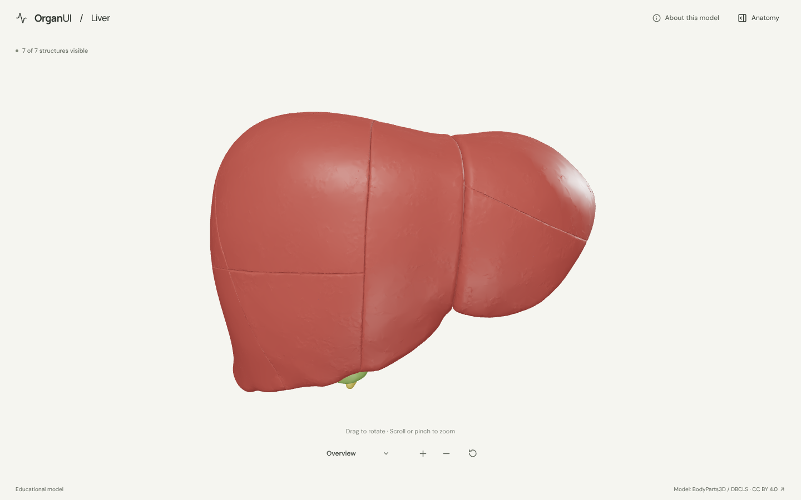
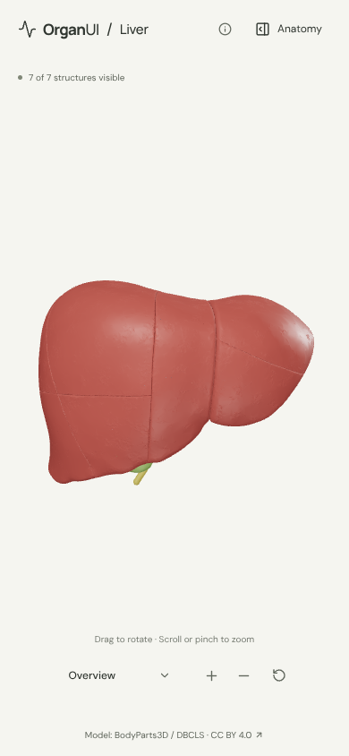

# OrganUI Liver

A working, open-source 3D liver explorer built with React, TypeScript, Three.js, React Three Fiber, Vite, and Bun. Standalone; no sibling repository, service, account, or API key is required.



## Run locally

Verified with **Bun 1.4.2** on Linux:

```sh
git clone https://github.com/organui/liver-3d.git
cd liver-3d
bun install --frozen-lockfile
bun run dev --port 5175 --strictPort
```

Open [localhost:5175](http://127.0.0.1:5175). Choose a different port if it is occupied. The model and fonts are bundled; normal startup does not download anatomy data. The dev server binds to loopback.

```sh
bun run typecheck
bun test
bun run format:check
bun run verify:model
bun run build
bun run preview --port 4175 --strictPort
```

The production preview is then at [localhost:4175](http://127.0.0.1:4175). Output is static files in `dist/`. No public deployment has been performed. `bun.lock` pins the exact dependency graph. React 19 / React Three Fiber 9 follow the renderer's [documented compatibility pairing](https://github.com/pmndrs/react-three-fiber). The local scripts run Vite and TypeScript with Bun.

## Explore

- Open into a full-window model view with a compact camera menu. The warm neutral canvas, typography, header, and on-demand anatomy panel follow OrganUI Heart’s design.
- Drag to orbit; scroll or pinch to zoom. Focus the model and use arrow keys to rotate, or `+` / `-` to zoom. Zoom buttons and reset remain in the bottom toolbar.
- Open **Anatomy** to browse the structure tree: the liver surface plus **Blood vessels** and **Biliary system** groups. The tree is the OrganUI registry [`anatomy-tree`](docs/REGISTRY_INTEGRATION.md) component, installed with the shadcn CLI. Select anatomy from the model or tree (a group name expands or collapses its group, and a model pick opens the group holding it); click the selected name on the canvas to open its details. Press `/` to open and focus the tree search, which matches structure and group names. Selecting a hidden structure makes it visible; choosing an internal structure reveals the liver surface.
- Hide or show a structure or a whole group from the tree (a partly hidden group reads "Mixed"), isolate the current selection, restore all, or reset the complete scene, camera, and tree search.
- Choose overview, anterior, posterior, inferior, or superior from the camera dropdown. Arrow keys, Home/End, Enter, and Escape also operate the menu. Isolating a structure fits the camera to it; opening or closing Anatomy preserves the viewing angle.
- Follow a four-step guided exploration inside the anatomy panel. Every structure has accessible text, source links, and notes on what its model represents. On mobile, **View in 3D** closes the panel and returns to the model.
- Use the responsive mobile layout, keyboard controls, visible focus indicators, and credits dialog. Reduced motion disables orbit damping and UI transitions; there is no automatic rotation or camera animation.
- Loading progress, unavailable-model retry, and WebGL failure states keep the text interface usable when 3D cannot load.

Seven selectable groups: **liver surface, gallbladder, portal vein, hepatic veins, hepatic artery, hepatic bile ducts, and cystic duct**. No independently selectable lobes or clinically reviewed functional segments are claimed.



## Models, attribution, and review

The 5.6 MB GLB contains 77 selected elements from BodyParts3D 4.0. It ships in ordinary Git; the 136 MiB raw archive stays in ignored `.asset-cache/`.

**BodyParts3D, © The Database Center for Life Science licensed under CC Attribution 4.0 International.** The [current official archive license](https://dbarchive.biosciencedbc.jp/en/bodyparts3d/lic.html) grants CC BY 4.0. Original mesh comments retain an older CC BY-SA 2.1 Japan notice; that discrepancy, source snapshots, exact identifiers, checksums, coordinate transform, and regeneration steps are documented in [model provenance](docs/MODEL_PROVENANCE.md). Runtime assets retain their [separate model license](public/models/LICENSE.txt); rendered screenshots retain model attribution.

Source tissue pieces are combined into one surface, with their seams retained. Internal anatomy comes from explicitly mapped meshes. Colors are illustrative, vessels and ducts are simplified, and the model is incomplete. It does not include the inferior vena cava, common bile duct, surrounding organs, or microscopic anatomy.

**Educational interface demonstration; expert anatomical review is pending.** Labels and geometry were checked during development, but this is not clinically validated, patient-specific, or a tool for diagnosis or surgical planning. Physiological simulation, disease overlays, and treatment features are outside scope.

To regenerate the bundled model, run `bun run prepare:model`, then `bun run verify:model`. This downloads pinned official inputs if absent and rejects mismatched SHA-256 hashes. It runs independently of other OrganUI repositories. Full details are in [MODEL_PROVENANCE.md](docs/MODEL_PROVENANCE.md).

## Verification

Type checking, production build, formatting check, runtime model integrity, visibility-state regression tests, and anatomy-adapter tests pass. The registry tree integration was checked in headless Chromium at 1440 × 900 and 390 × 844 on 2026-10-16 (search, tree and 3D selection, colour swatches, group rows expanding instead of selecting, a 3D pick revealing its row in a collapsed group, leaf and group visibility, restore, reset, Escape focus return, no console errors or mobile overflow); screen-reader testing was not done. A clean copy with no dependencies, raw model cache, or sibling checkouts installed from `bun.lock`, built successfully, and passed model verification. The refreshed layout, including the 2026-10-03 polish pass, was inspected at 1440 × 900, 800 × 700, and 390 × 844, including collapsed and expanded anatomy panels. Rendering and interactions were checked in a Chromium browser; see [verification evidence and manual steps](docs/VERIFICATION.md).

Known engineering limits: Three.js creates a roughly 969 kB minified engine chunk (257 kB gzip), producing Vite's size warning. The scene is loaded separately. React Three Fiber emits a non-fatal `THREE.Clock` deprecation warning against Three.js 0.186. No application errors were observed in the final normal production preview. Physical iOS/Android, Safari/Firefox, assistive-technology audits, and performance on low-end devices have not been tested.

## License

Original code: [MIT](LICENSE). Anatomy assets: [CC BY 4.0 and source notice](public/models/LICENSE.txt). Fonts: SIL OFL 1.1; icons: ISC; notices are included in [public/licenses](public/licenses).

Part of [OrganUI](https://github.com/organui), alongside [OrganUI Heart](https://github.com/organui/heart-3d). This repository remains independent of both the Heart checkout and the OrganUI website monorepo.
